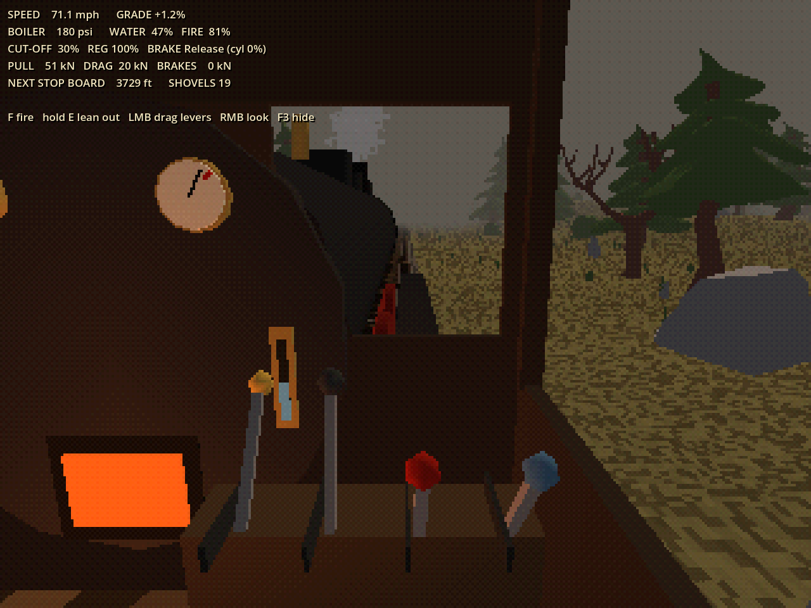
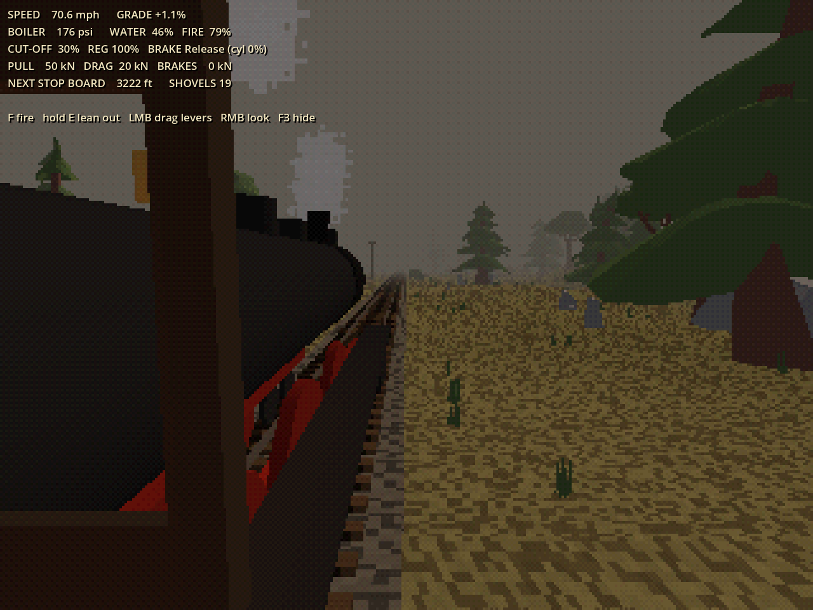

# Last Train

Semi-realistic 1930s steam locomotive survival sim in a procedurally generated, eldritch-haunted world,
rendered in PlayStation 1 style. See [DESIGN.md](DESIGN.md) for the vision and decisions.

**Status:** Slice 1 "The Engine": one locomotive on a straight test track with rolling grades.




## Requirements

- Godot **4.7.2 .NET** build
- .NET SDK 8

## Run

Open the folder in Godot, let it build the C# project, press F5.

## How to drive

You start cold: brakes on, low fire, 45 psi.

1. **Raise steam.** Click the firebox door (or press `F`) a few times. Watch the pressure gauge climb toward the red line (200 psi).
2. **Set the reverser** forward, all the way over (full cut-off) for starting.
3. **Release the brake** (drag the red lever all the way back to *Release*). The brakes take a few seconds to come off.
4. **Open the regulator** (brass knob) gently.
5. Once rolling, **notch the reverser back** toward 25-35% cut-off. Long cut-off at speed empties the boiler fast; short cut-off is efficient.
6. **Keep the fire and water up.** Use the injector (blue) to add water; it only works with pressure. Don't let the water glass empty over a hot fire.
7. **Stop at the red stop boards.** The brakes lag, so plan ahead. The HUD tells you how close you got.

| Input | Action |
|---|---|
| Left-drag a lever | Move it up/down. It stays where you leave it (detents snap) |
| Left-click firebox door / `F` | Fire a shovelful of coal |
| Hold `E` | Lean out of the side window to see past the boiler |
| Right-drag | Look around |
| `F3` | Toggle dev readout |

## Project layout

```
src/Simulation/   Pure C# physics: boiler, air brake, locomotive, levers, track profile. No Godot types.
src/Render/       PS1 pipeline (low-res viewport + dither), material/mesh helpers, model loader
src/World/        Track and scenery around the train
src/Train/        Locomotive and tender body, smoke
src/Cab/          Levers, gauges, cab interior, mouse input
src/Audio/        Procedural placeholder sounds (chuffs, rail joints, fire, safety valve)
src/UI/           Dev HUD
src/Tools/        AutoShot: scripted screenshot run
shaders/          PS1 surface shader and post-process
assets/           Third-party CC0 models (Quaternius)
tests/            xUnit tests for src/Simulation
```

## Windows build

Every push to `main` runs the tests and exports a Windows build on GitHub Actions
(`.github/workflows/build.yml`). Download it from the run's **Artifacts** ("LastTrain-windows").

To export locally (needs the 4.7.2 .NET export templates installed):

```bash
godot --headless --path . --export-release "Windows Desktop" build/windows/LastTrain.exe
```

## Credits

- Nature models: [Quaternius](https://quaternius.com) "Ultimate Nature" pack, CC0 (`assets/quaternius/`).

## Tests

```bash
dotnet test tests/LastTrain.Tests
```

## Automated screenshots

Plays a scripted run and writes PNGs, then quits. Useful for checking the look without playing:

```bash
godot --path . -- --autoshot=/absolute/output/dir
```
